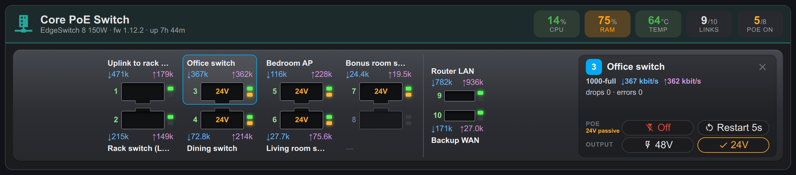
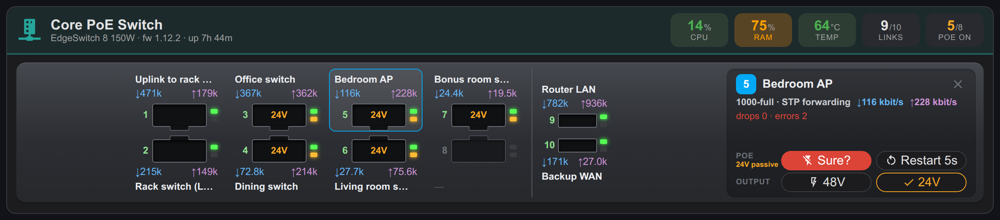
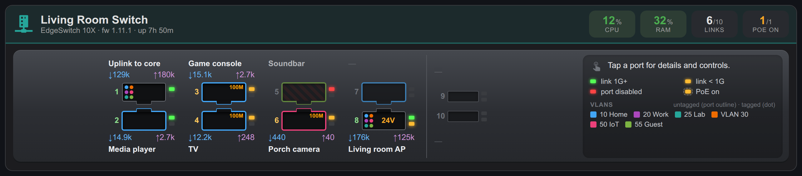
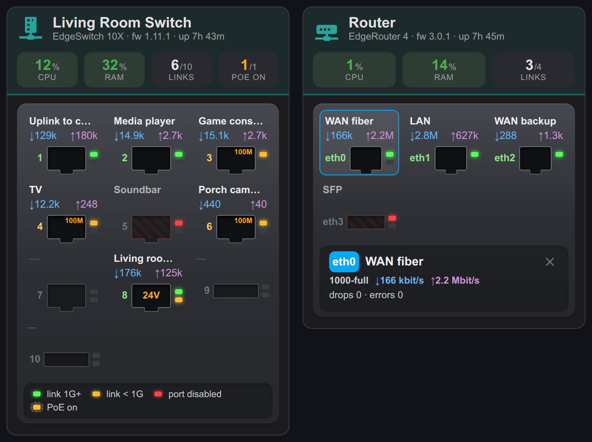

# UISP NMS for Home Assistant

*Unofficial: not made, supported or endorsed by Ubiquiti.*

Monitor and control the devices managed by a self-hosted UISP (UNMS) server — EdgeRouters, EdgeSwitches and other Ubiquiti devices — through UISP's API with a single API token. No device passwords are stored in Home Assistant.

## What you get

Per device:
- **Connected to UISP** (binary sensor; stays available when the device is unreachable)
- **CPU usage**, **Memory usage**, **Last boot**, and **Temperature** where the device reports one

Per physical port (switch ports, router `ethN`; not VLANs or LAGs):
- **Link** (binary sensor) with negotiated speed, port description, PoE output, PoE power, STP state and VLANs (untagged and tagged, with names where known) as attributes
- **RX rate** / **TX rate** (Mbit/s), with error and drop counters as attributes
- **PoE** switch on ports that can supply power
- **PoE output** select on ports offering more than one output (e.g. ES-8-150W: off / active 48V / 24V passive)
- **Enabled** switch to turn the port on or off — *disabled by default*, see below

A **dashboard card** showing a device's front panel, with PoE control (see [Dashboard card](#dashboard-card)).

Service **`uisp_nms.power_cycle_port`**: turns a port's PoE off, waits (default 5 s) and turns it back on with the same output — handy for a stuck access point or camera.

## Safety

- **PoE voltage is never guessed.** Turning a PoE switch on restores the output the port last used (remembered across restarts). On ports with several outputs and no known last output, turning on is refused; pick the output with the **PoE output** select. Passive 24V into a device that expects 802.3af/at (or the reverse) can damage it or leave it unpowered.
- **PoE can power other switches.** If a switch is powered from another switch's PoE port, turning that PoE off (or power-cycling it) takes down the downstream switch and everything behind it.
- **Port enable switches are disabled by default.** Disabling the port a device uses to reach UISP cuts it off, and it can then only be re-enabled locally on the device. Enable only the ones you need, in **Settings → Devices & services → UISP NMS → entities**.

## Requirements

- Home Assistant 2026.2 or later (tested on 2026.2.3 and 2026.10.0)
- A self-hosted UISP server (tested with UISP 3.1.65: ER-4, ES-10X, ES-8-150W, ES-24-Lite)
- A UISP API token (**UISP → Settings → Users → API Tokens**, as an admin). A read-only token is enough for monitoring; PoE and port control need a token with write access.

## Install

1. In HACS, add `https://github.com/jeffgkd705/ha-uisp-nms` as a custom repository (type: Integration) and install **UISP NMS**. Or copy `custom_components/uisp_nms` into your Home Assistant `config/custom_components/` folder.
2. Restart Home Assistant.
3. **Settings → Devices & services → Add integration → UISP NMS**. Enter the UISP URL (e.g. `https://uisp.example.com`) and the API token.
4. If UISP uses its default self-signed certificate, you are shown its SHA-256 fingerprint. Check it matches your server (for example in the browser's certificate viewer) and submit to trust exactly that certificate. If the certificate is ever replaced, the integration stops connecting until you confirm the new one with **Reconfigure**.

## Dashboard card

The integration ships a card that draws a device's front panel, with link and PoE lights, speed, current rates, PoE output and VLANs for each port, and CPU, RAM, temperature, links and PoE in the header. You can turn PoE on and off, restart it and change its output from the card.



### Add the card

The card is loaded on every dashboard automatically, so there is no resource to add.

1. Open a dashboard, click the **pencil** (Edit dashboard) at the top right, then **+ Add card**.
2. Search for **UISP NMS** and choose **UISP NMS switch**.
3. Pick the **Device** (one card per switch or router) and click **Save**.
4. Recommended: protect the uplink ports. In the card editor, click **Show code editor** and add `protect:` with the port numbers that connect the device to the rest of your network, e.g. `protect: [1]`. Those ports get no disable button.

The same card in YAML:

```yaml
type: custom:uisp-nms-card
device: Living Room Switch   # device name (as shown in Home Assistant) or device id
protect: [1]                 # ports that can't be disabled from the card (uplinks)
```

If the card picker does not list **UISP NMS switch**, or the dashboard shows *Custom element doesn't exist: uisp-nms-card*, restart Home Assistant after installing or updating, then reload the page with **Ctrl+F5** (**Cmd+Shift+R** on a Mac).

### Use the card

- **Read the panel.** Each port shows its UISP description, current download (↓) and upload (↑) as seen by the connected device, and two lights: green for a link at 1 Gbit/s or more, amber for a slower link (the speed is printed in the jack), red for a disabled port. The second light is amber when the port supplies PoE, and the jack shows the output (24V, 48V) or the power drawn. Hover over a port for its error and drop counters.
- **VLANs.** A port's untagged VLAN colors its outline, and each tagged VLAN adds a dot in the jack; the legend lists the device's VLANs. VLAN 1 (the default) is not colored. A VLAN has the same color on every card. Names come from the descriptions of the router's VLAN interfaces in UISP (for example `eth1.10` "Home"), otherwise from the VLAN names configured on the switches; VLANs without either are shown by number.
- **Tap a port** for its details and controls. Tap it again, the ✕, or press **Esc** to close them.
- **PoE**: **Off**/**On** and **Restart** (off for 5 seconds, then back on with the same output, via the `uisp_nms.power_cycle_port` action).
- **Output**: on ports that offer more than one PoE output (ES-8-150W: 48V 802.3af/at and 24V passive), the current one is ticked. **Check what the powered device accepts before changing it**: 48V on a 24V-passive device can damage it.
- **Port**: enable/disable appears only for ports whose *enabled* entity you have turned on (they are disabled by default; see [Safety](#safety)).
- **Confirm**: turning PoE or a port off, restarting PoE and changing the output need a second tap. The button turns red and says **Sure?** for 4 seconds.





On narrow screens the ports wrap and the details move below them. Routers are drawn on one row, with the SFP port separate.



### Options

| Option | Default | Description |
|--------|---------|-------------|
| `device` | first UISP NMS device | Device name or id |
| `protect` | `[]` | Ports (numbers, or names like `eth1`) without a disable button. Protect the ports that connect Home Assistant to the device: once disabled, it could not re-enable them |
| `sfp` | from the model | SFP port numbers, drawn as cages |
| `cycle_seconds` | `5` | Off time for **Restart** |
| `accent` | teal | Header color, e.g. `'#5c6bc0'` |
| `vlan_colors` | built-in palette | Colors by VLAN id, e.g. `{50: '#ef6c00'}` |

## Notes

- UISP is polled every 30 seconds: one request for the device list plus one per connected device. After a change, the port is re-read 5 seconds later, because UISP answers before the device has applied it. A change takes about 3 seconds to go through UISP.
- Data rates come from UISP's `rxrate`/`txrate` (bits per second).
- Switch VLANs (names and port membership) come from UISP's VLAN configuration of each switch, which rarely changes, so it is read when the integration starts and then every 10 minutes rather than every 30 seconds. VLAN changes can take up to 10 minutes to show. VLAN ranges are not shown.
- The integration's icon ships in `custom_components/uisp_nms/brand/` and is shown by Home Assistant 2026.3 or later; older versions show a placeholder. It is an original design, not Ubiquiti's logo.
- Avoid opening UISP's API documentation page (`/nms/api-docs`) on small servers: generating it took over 100 seconds of CPU on UISP 3.1.65, made UISP restart its API and disconnected all devices.

## Development

```bash
uv venv --python 3.14 .venv
uv pip install --python .venv/bin/python pytest-homeassistant-custom-component
.venv/bin/python -m pytest
```

Tests run against an in-memory fake of the UISP API (`tests/conftest.py`).

## Acknowledgements

This integration started from [marosmars/edgeswitch-homeassistant](https://github.com/marosmars/edgeswitch-homeassistant) by Maros Marsalek, which controls EdgeSwitches through their own web API. Its structure was the model for this one; the dashboard card is adapted from its `edgeswitch-card`, and the `power_cycle_port` action from its `cycle_port` service. See [THIRD_PARTY_NOTICES.md](THIRD_PARTY_NOTICES.md) for its license.

## License

MIT. See [LICENSE](LICENSE).
